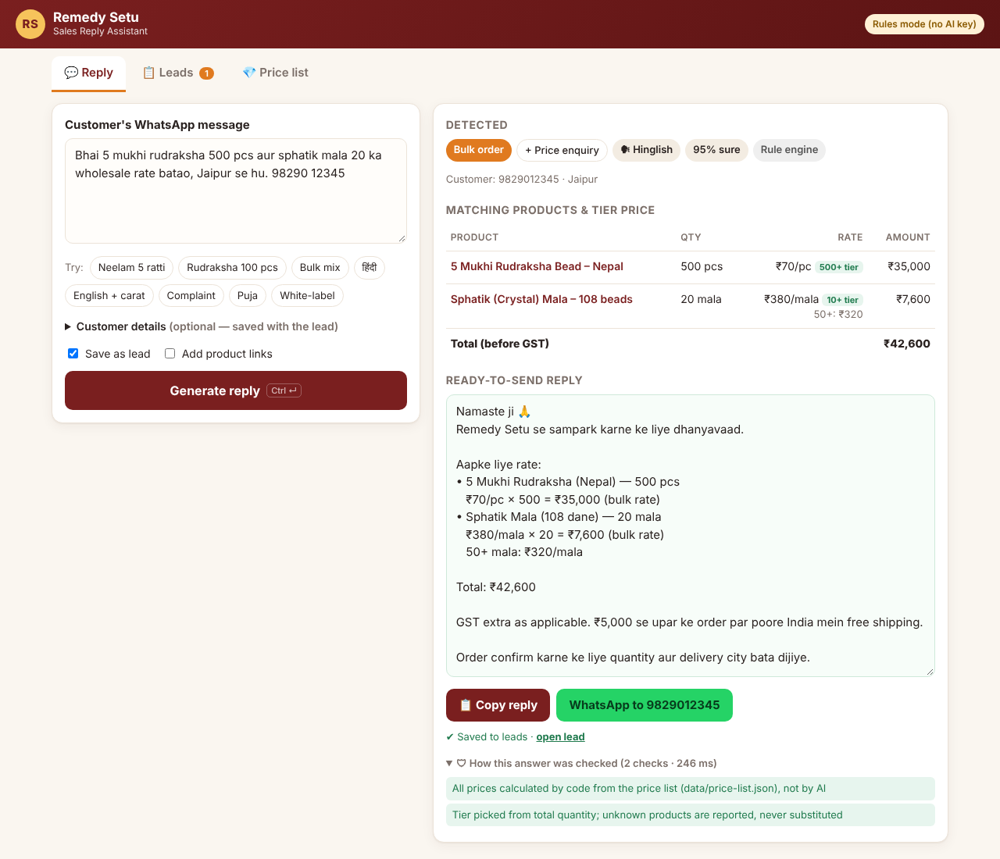
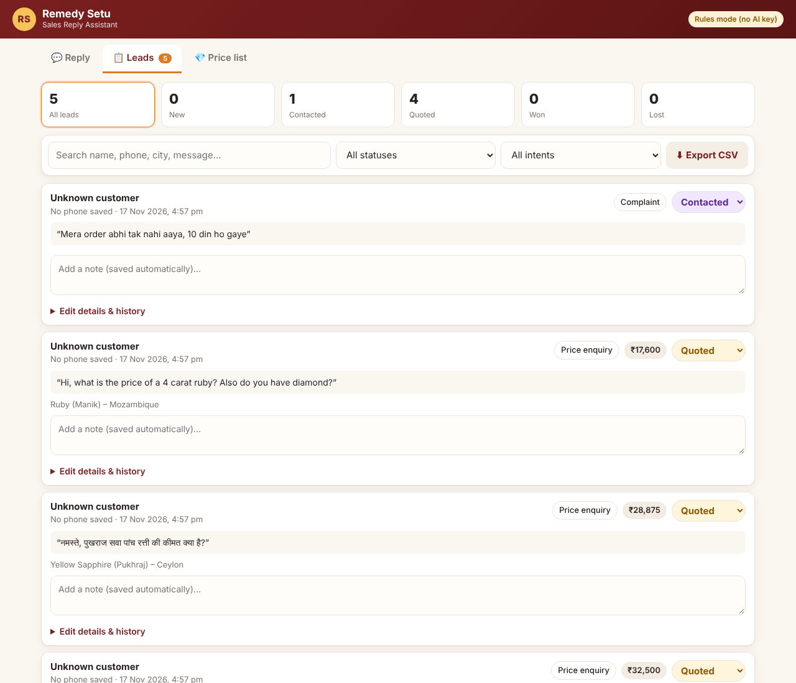
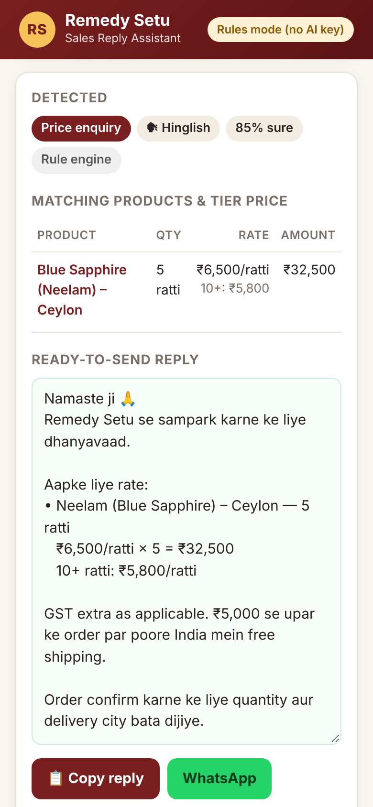

# Remedy Setu – AI Sales Reply Assistant

**Assignment option 3.** The sales team pastes a customer's WhatsApp message, for example *"Neelam ka rate kya hai 5 ratti?"* or *"Rudraksha 100 pcs chahiye"*. The tool returns:

1. **The intent**: price enquiry, bulk order, order request, complaint, order status, white-label, puja booking, availability, authenticity, greeting.
2. **The matching products and the correct quantity-tier price** from our price list (22 products: gemstones, rudraksha, malas, yantra, pujas).
3. **A ready-to-send reply in the customer's language**: English, Hinglish or Hindi (Devanagari). There are Copy and WhatsApp buttons.
4. **Bonus:** every query is saved as a **lead**. The Leads page has a status pipeline (New → Contacted → Quoted → Won / Lost), notes, search, filters and CSV export.

> **Key design rule: the AI never decides a price.** The AI is used to understand messy messages and to make the reply sound natural. Every product and price comes from `data/price-list.json`, and code checks every AI output. If the AI invents a product, a quantity, a price or a discount, its output is rejected and the verified template is used.



| Leads pipeline | Mobile |
|---|---|
|  |  |

---

## Run it locally (under 5 minutes)

**You need:** [Node.js](https://nodejs.org) 18 or newer (LTS recommended).

**Option 1: double-click**
- Windows: `start-windows.bat`
- Mac / Linux: `./start-mac-linux.sh`

**Option 2: terminal**
```bash
npm install
npm start
```
Then open **http://localhost:3000**.

The tool works without any API key. It runs in *Rules mode*, using the built-in multilingual rule engine.

### Turn on AI (optional, free)
1. Get a free key from [Google AI Studio](https://aistudio.google.com/apikey) (Gemini) or [Groq](https://console.groq.com/keys).
2. Copy `.env.example` to `.env` and paste the key: `GEMINI_API_KEY=...` (or `GROQ_API_KEY=...`).
3. Restart with `npm start`. The header now shows **"AI on · gemini"**.

Any OpenAI-compatible API also works (`OPENAI_API_KEY`, `OPENAI_BASE_URL`, `OPENAI_MODEL`).

### Run the tests
```bash
npm test
```
There are 21 tests. They cover the parser, tier pricing and guardrails, plus two end-to-end tests against a **mock AI server**. In the first, the mock AI deliberately invents a product and a wrong price, and the tests check that both are blocked.

---

## Tech stack

| Part | Choice | Why |
|---|---|---|
| Backend | Node.js + Express (one dependency) | Simple, fast to run, easy to deploy anywhere |
| Frontend | Plain HTML/CSS/JS, mobile-first | No build step, works on any phone, easy for a non-technical team |
| AI | Gemini (free tier) / Groq / OpenAI-compatible, via `fetch` | Provider can be swapped with one env variable; no SDK lock-in |
| Data | `data/price-list.json` (catalogue), `data/leads.json` (leads) | Zero database setup for local runs; storage is isolated in `src/store.js` so it can move to Postgres/Supabase |
| Tests | Node's built-in `node:test` | No extra dependencies |

---

## How it works

```
 WhatsApp message
       │
       ▼
 ┌────────────────────┐   always runs, no API needed
 │ 1. Rule engine     │   language · intent · products · mukhi · ratti/carat/pcs · phone/city
 │    src/parser.js   │
 └─────────┬──────────┘
           ▼
 ┌────────────────────┐   optional (when an AI key is set)
 │ 2. AI understanding│   returns JSON: intent + product IDs + quantities
 │    src/ai.js       │──►  GUARDRAIL: unknown product IDs dropped, quantities must appear
 └─────────┬──────────┘     in the message, product must actually be mentioned
           ▼
 ┌────────────────────┐
 │ 3. Pricing (code)  │   tier picked from total quantity, totals calculated
 │    src/catalog.js  │   ONLY source of prices = data/price-list.json
 └─────────┬──────────┘
           ▼
 ┌────────────────────┐
 │ 4. Template reply  │   EN / Hinglish / Hindi, built from verified facts only
 │    src/replies.js  │
 └─────────┬──────────┘
           ▼
 ┌────────────────────┐   optional
 │ 5. AI polish       │   rewrites the draft to sound human
 │                    │──►  GUARDRAIL: every number must exist in the verified draft,
 └─────────┬──────────┘     no un-quoted product names, no new "discount/offer/guarantee"
           ▼               → otherwise rejected, template used
   Reply + lead saved
```

If any AI step fails (no key, timeout, bad JSON, failed checks), the tool falls back to the rule engine. The agent always gets a correct answer. The UI's **"How this answer was checked"** panel shows every guardrail decision.

### What the rule engine understands
- **3 languages:** English, Hinglish (*"kitne ka hai"*), Hindi (*"कीमत क्या है"*), including Devanagari digits (५).
- **Product names and spellings:** *neelam / nilam / neelum / blue sapphire / नीलम*, plus typo tolerance (*pukhraaj* → Pukhraj).
- **Quantities:** `5 ratti`, `4 carat` (converted: 1 ratti = 0.91 ct), `100 pcs / nag / dane`, `20 mala`, `2k pcs`, `5 sau`, `paanch ratti`.
- **Astrology weights:** *sava 5* = 5.25, *sade 5* = 5.5, *paune 6* = 5.75.
- **Rudraksha:** *5 mukhi / panchmukhi / पंचमुखी*, mala or bead. With no mukhi given it assumes 5 Mukhi and asks the customer to confirm. A mukhi we don't stock (e.g. 3 Mukhi) is reported as *not in price list*, never substituted.
- **Several products in one message:** each gets its own quantity (*"rudraksha 500 pcs aur sphatik mala 20"*).
- **Products we don't sell** (diamond, zircon...): the reply politely says so.
- **Customer details:** phone number and city are pulled from the message and saved on the lead.

### Pricing rules
- Every product has tiers, e.g. 5 Mukhi Rudraksha: 1+ ₹150, 10+ ₹120, 100+ ₹90, 500+ ₹70 per piece.
- Gemstones are priced **per ratti**. The tier is based on total ratti, so 10 stones × 5 ratti = 50 ratti gets the 50+ tier.
- The reply also shows the **next tier** ("500+ pcs: ₹70/pc") to encourage bigger orders.
- If a gemstone weight is missing, the reply shows the per-ratti tier table and asks for the weight.

---

## Project structure

```
├── server.js              Express server + API routes
├── src/
│   ├── parser.js          Rule engine: language, intent, products, quantities, customer details
│   ├── catalog.js         Loads/validates the price list, tier pricing (the only place prices are calculated)
│   ├── replies.js         Reply templates in English / Hinglish / Hindi
│   ├── ai.js              The two AI prompts (understand, polish)
│   ├── llm.js             Provider client: Gemini / Groq / OpenAI-compatible, timeout, JSON parsing
│   ├── guardrails.js      Validation of AI output (products, numbers, promises)
│   ├── analyze.js         Orchestrates the pipeline + fallbacks
│   └── store.js           Leads storage (JSON file, atomic writes), search, CSV
├── public/                Web UI (index.html, app.js, styles.css)
├── data/price-list.json   Product catalogue + tier prices (edit this to change prices)
├── test/                  Unit + mock-AI end-to-end tests
├── docs/                  Screenshots + video/interview notes
├── render.yaml            Free deploy on Render
└── .env.example           Config template (keys are never committed)
```

### Data model

**Product** (`data/price-list.json`)
```json
{ "id": "RUD-5M-BEAD", "category": "rudraksha", "rudraksha": { "mukhi": 5, "form": "bead" },
  "name": { "en": "...", "hinglish": "...", "hi": "..." }, "aliases": ["..."],
  "unit": "piece", "tiers": [{ "min": 1, "price": 150 }, { "min": 10, "price": 120 }, ...],
  "inStock": true, "note": "Original, X-ray tested", "url": "..." }
```

**Lead** (`data/leads.json`): one lead per phone number. Repeat customers get new queries added to their history.
```json
{ "id": "a1b2c3d4", "name": "", "phone": "9876543210", "city": "Jaipur", "status": "Quoted",
  "notes": "", "lastIntent": "bulk_order", "createdAt": "...", "updatedAt": "...",
  "queries": [{ "at": "...", "message": "...", "intent": "...", "language": "hinglish",
                "products": [{ "id": "...", "qty": 500, "unitPrice": 70, "total": 35000 }],
                "quoteTotal": 42600, "reply": "..." }] }
```

### API
| Method | Path | Purpose |
|---|---|---|
| POST | `/api/analyze` | `{ message, customerName?, phone?, city?, saveLead?, includeLinks?, useAI? }` → intent, priced lines, reply, guardrail log, lead |
| GET | `/api/leads?q=&status=&intent=` | List + stats |
| PATCH | `/api/leads/:id` | Update status / notes / name / phone / city |
| DELETE | `/api/leads/:id` | Delete lead |
| GET | `/api/leads.csv` | CSV export (opens in Excel with Hindi intact) |
| GET | `/api/catalog` | Price list |
| GET | `/api/health` | Status + whether AI is on |

---

## Deploy (free)

**Render:** push to GitHub, then on render.com choose **New → Blueprint** and pick the repo (`render.yaml` is included). Add `GEMINI_API_KEY` and, optionally, `APP_PASSWORD` in the dashboard.
On the free plan the disk resets on redeploy, so leads in `leads.json` are temporary there. For production, swap `src/store.js` for Postgres or Supabase.

**Railway / any Node host:** build `npm install`, start `npm start`, set env vars.

**Login:** set `APP_PASSWORD` to protect the whole tool (username `sales`).

---

## Features done
- [x] Paste message → intent (10 intents, with secondary intents and confidence)
- [x] Matching products + quantity-tier price + totals + next-tier upsell
- [x] Ready-to-send reply in the customer's language (EN / Hinglish / Hindi)
- [x] Copy button + open in WhatsApp (pre-filled, to the customer's number when known)
- [x] Works without AI (rule engine). With AI: Gemini / Groq / OpenAI-compatible
- [x] Guardrails against invented products, prices, quantities and promises, with a visible check log
- [x] Handles products we don't sell, missing weight, missing mukhi, carat → ratti, typos, multiple products
- [x] Complaint / delivery-delay / order-status / white-label / puja replies
- [x] **Bonus:** every query saved as a lead. Repeat customers are merged by phone; pipeline status, notes, search, filters, CSV export
- [x] Price list page with search
- [x] Mobile-friendly UI, optional password, tests, one-click start scripts, Render blueprint

## What I'd add next
1. **WhatsApp Business API webhook**, so messages arrive automatically and the agent just approves the reply (no copy-paste).
2. **Price list editor in the UI** (admin only) and a Google Sheet sync, so founders can change rates without touching JSON.
3. **Postgres / Supabase** for leads, plus per-agent logins and an activity log.
4. **Quote PDF** generation and a "send quote" button.
5. **Learning loop:** store the agent's edits to replies and use them as examples to improve the prompts. Track which intents get misread.
6. Customer-specific pricing (key-account rates) and stock levels from inventory.

## Assumptions
- Prices, product names, notes and links in the price list are **sample data** I created for the assignment (product URLs are placeholders).
- Ratti conversion uses 1 ratti = 0.91 carat.
- GST and the shipping line are a single configurable note in `price-list.json` → `meta.priceNote`.
